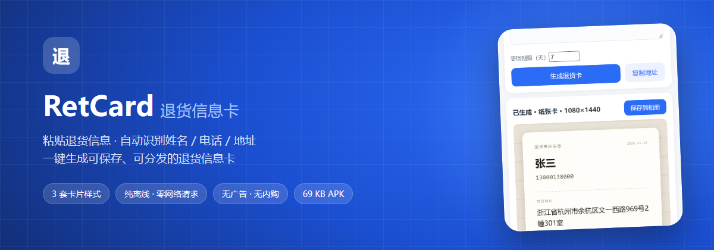
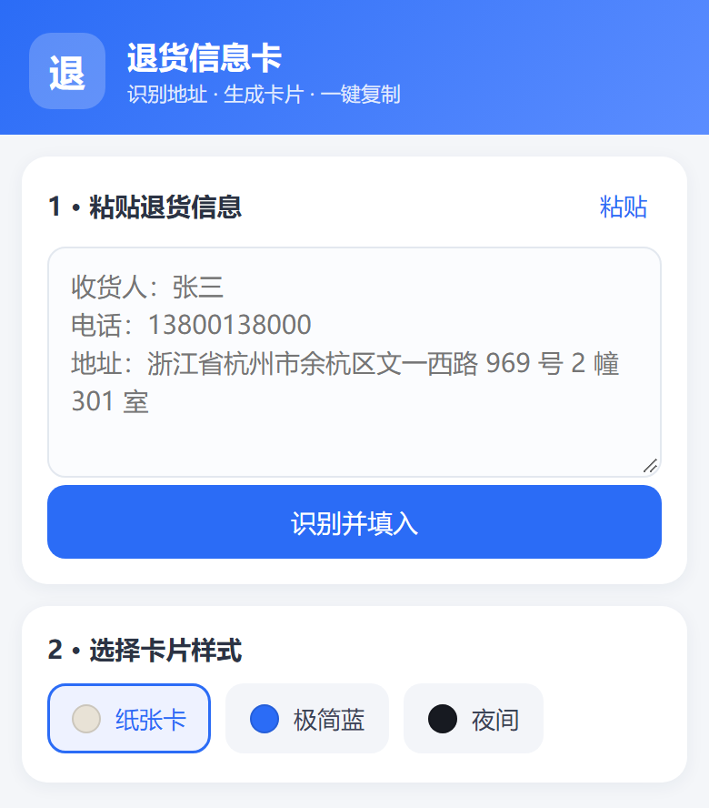
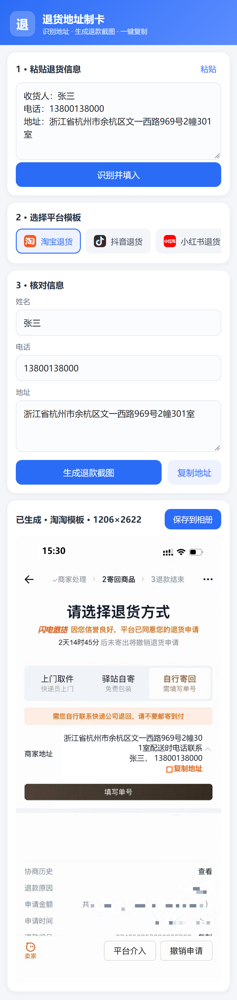
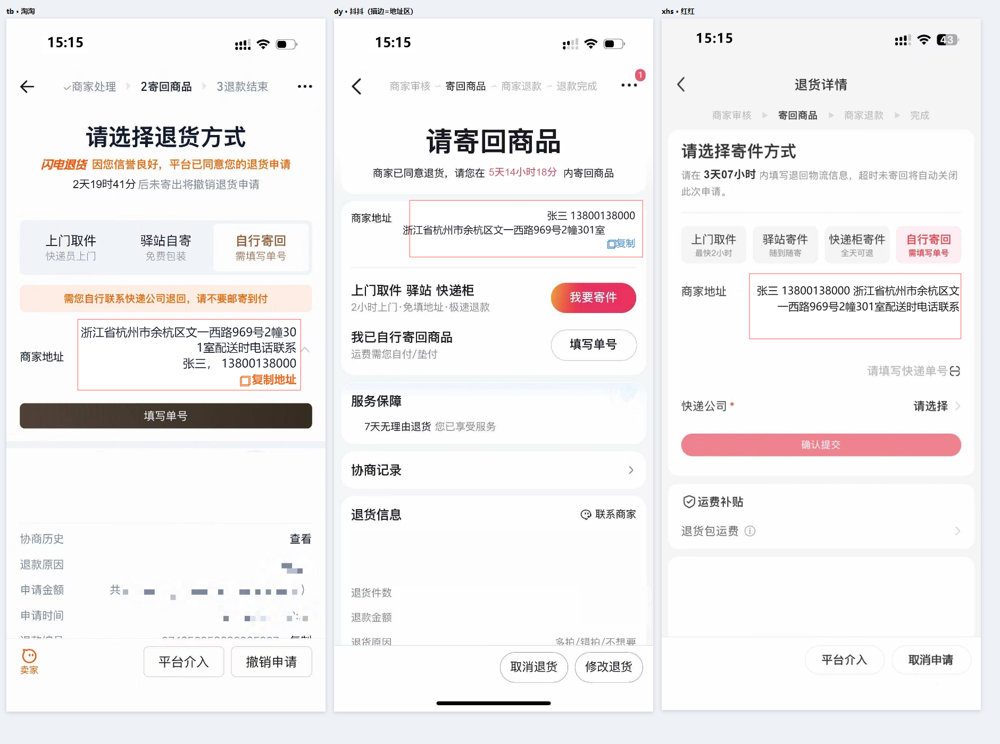

<div align="center">



# RetCard · 退货地址制卡

**粘贴一段退货信息，一键生成电商退货卡图。**

淘宝 / 抖音 / 小红书 / 拼多多 四套模板 · 纯离线渲染 · 无广告 · 无账号 · 无网络请求

[(https://github.com/zhankim/retcard)
[(https://github.com/zhankim/retcard)
[(https://github.com/zhankim/retcard)
[(https://github.com/zhankim/retcard)
[](https://github.com/zhankim/retcard/blob/main/LICENSE)

</div>

---

## 这是什么

退货时电商平台只给一个「商家地址」，复制粘贴到聊天框里既难读又容易漏。RetCard 把它排成平台原生的**退货卡图**：地址、收件人、电话、退货倒计时一次性排好，直接发给商家，或打印出来随包裹寄回。

整个 App 只有三件事：

1. **识别** —— 粘贴任意格式的退货信息，自动拆出姓名 / 电话 / 详细地址
2. **生成** —— Canvas 按模板坐标重绘成 1206×2622 的退货详情页
3. **输出** —— 存相册，或一键复制地址

没有登录，没有会员，没有激励视频，没有次数限制。

---

## 截图

<table>
<tr>
<td width="50%" align="center"><br><sub>粘贴 → 识别</sub></td>
<td width="50%" align="center"><br><sub>核对 → 生成卡片</sub></td>
</tr>
</table>



---

## 功能

| | 能力 | 说明 |
|---|---|---|
| 🧠 | 地址智能识别 | 支持「收货人：张三 / 电话：138… / 地址：浙江省…」这类带标签文本，也支持纯文本连写；手机号、固话、400 电话、直辖市缺「市」都能兜住 |
| 🎨 | 四套平台模板 | 淘宝 1206×2622、抖音 1206×2622、小红书 1200×2602、拼多多 1206×2622 |
| ⏱ | 随机退货倒计时 | 按模板给定区间生成（如 1天00时00分 ~ 6天23时59分），观感与原页面一致 |
| 📋 | 一键复制地址 | 姓名 + 电话 + 地址拼成一行，直接粘贴给商家 |
| 💾 | 保存到相册 | Android 10+ 走 MediaStore 免权限，落在 `Pictures/RetCard/` |
| ✂️ | 溢出保护 | 地址超过模板行数会提示「地址过长，请缩短后再生成」，不会画糊 |

---

## 下载 / 安装

前往 [Releases(https://github.com/zhankim/retcard) 下载 `RetCard-1.0.apk`，或直接用仓库根目录里的成品：

```text
RetCard-1.0.apk          0.75 MB
package    com.pineapple.retcard
minSdk     23 (Android 6.0)
targetSdk  34
签名       CN=菠萝包  ·  v1 + v2 + v3
```

> 首次安装需在系统里允许「安装未知来源应用」。

---

## 从源码构建

不依赖 Gradle、AndroidX、Kotlin，只用 SDK 自带的 `aapt2` / `d8` / `apksigner`：

```bash
# 需要: JDK 17+ / Android SDK build-tools 35 / Python 3（打包 dex）
powershell -ExecutionPolicy Bypass -File .\build.ps1
```

构建链路：

```text
aapt2 compile   →  res.zip
aapt2 link      →  base.apk（含 assets/www）
javac -source 8 →  classes/          （仅 MainActivity + R）
d8 --min-api 23 →  classes.dex
zip append      →  unsigned.apk
zipalign -f 4   →  aligned.apk
apksigner sign  →  RetCard-1.0.apk  （v1/v2/v3）
```

首次运行会自动生成签名密钥（`pineapple.keystore`，口令 `pineapple123`）；正式分发请换成自己的密钥，别把私钥提交进仓库。

---

## 项目结构

```text
retcard/
├── app/
│   ├── AndroidManifest.xml
│   ├── java/com/pineapple/retcard/
│   │   └── MainActivity.java          WebView 壳 + 相册/剪贴板 JS Bridge
│   ├── res/                            图标（5 密度）、主题、字符串
│   └── assets/www/
│       ├── index.html                  单页 UI
│       ├── style.css
│       ├── templates.js                4 套模板坐标（唯一需要改的配置）
│       ├── images.js                   模板底图 base64（约 1.1 MB）
│       └── app.js                      地址解析 + Canvas 渲染 + 交互
├── preview/                            渲染自检页（浏览器直接打开）
│   ├── test.html                       一次渲染 4 套模板
│   ├── big.html                        描红地址区，检查文字溢出
│   └── measure.html                    布局尺寸测量
├── docs/                               README 用图与 banner 源文件
├── build.ps1                           一键构建
└── RetCard-1.0.apk                     成品
```

---

## 模板系统

所有版式都集中在 `assets/www/templates.js`，一个模板长这样：

```js
tb: {
  alias: "淘淘", imgKey: "tb",
  canvasWidth: 1206, canvasHeight: 2622,
  replace: {
    time: { cover: {...}, text: {...} },                      // 顶栏时间
    returnCountdown: { minText, maxText, cover, textStyle },   // 随机倒计时
    address: {
      type: "inline", mode: "tb", suffix: "配送时电话联系",
      cover: {...}, addressText: {...}, nameText: {...}, copyText: {...}
    }
  }
}
```

- `cover` 是盖住底图原文字的矩形，`x/y/w/h` 直接对应底图像素坐标
- `type` 支持 `inline`（地址与姓名分开排）/ `card`（拼多多那种带「商家地址：」标签的卡片）/ `jdPickup`
- 加模板只做两件事：把底图放进 `images.js`，再照抄一份配置改坐标

调坐标时打开 `preview/big.html`，它会把 `cover` 矩形描红，一眼看出文字有没有溢出。

---

## 三个踩过的坑

**1. `file://` 页面画本地图片会污染 canvas**

WebView 里 `drawImage()` 加载 `file://` 图片后，`canvas.toDataURL()` 直接抛 `SecurityError`（opaque origin）。解法是把模板图转成 base64 内嵌进 `images.js`。

**2. 中文路径喂给 java 工具必炸**

`keytool` / `apksigner` 按平台编码解析参数，`菠萝包.keystore` 传进去变成乱码路径 → `FileNotFoundException`。做法是签名时用 ASCII 副本，签完再改回中文名。

**3. 原模板的两处坐标假设**

- `lastLineX` 本意是「整段只有一行时右移对齐」，多行时仍会生效，导致最后一行冲出画布 —— 改为仅单行时应用
- 抖音模板的「复制」按钮与地址末行同 `y`，两行地址时会叠字 —— 改为始终落在末行下一行

---

## 关于来源

本项目的前端排版逻辑（字符折行、cover 遮盖、倒计时区间、复制按钮绘制）重写自一个公开可下载的电商退货地址制卡小程序客户端代码；原程序依赖的云开发后端、会员付费、激励广告、次数配额、邀请体系已全部剥离。

本仓库不含任何服务端代码、密钥或用户数据，也不需要联网即可运行。

---

## 已知边界

- 字体走系统 CJK（Android 上是 Noto Sans CJK），与 iOS 的 PingFang SC 字形略有差异
- 未包含京东模板（原程序里即为维护中状态，底图缺失）
- 仅竖屏；地址超过模板 3 行会拒绝生成
- 未做平板 / 折叠屏适配

---

## License

[MIT](https://github.com/zhankim/retcard/blob/main/LICENSE) © RetCard contributors
