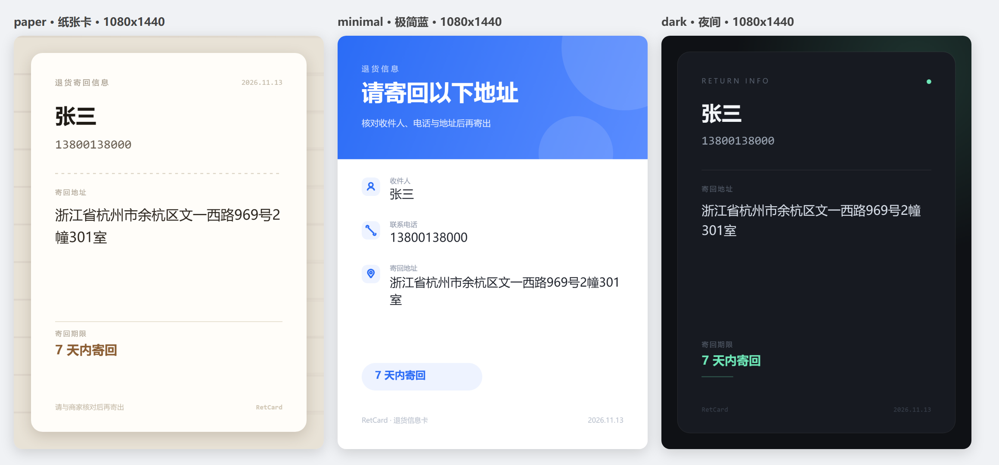

<div align="center">


# RetCard · 退货信息卡

**粘贴一段退货信息，一键生成可保存、可分发的退货信息卡。**

三套卡片样式 · 纯离线渲染 · 无广告 · 无账号 · 无网络请求

[](https://github.com/zhankim/retcard)
[](https://github.com/zhankim/retcard)
[](https://github.com/zhankim/retcard)
[](https://github.com/zhankim/retcard)
[](https://github.com/zhankim/retcard/blob/main/LICENSE)

</div>

---

## 这是什么

退货时商家只给一串地址，复制到聊天框里既难读又容易漏。RetCard 把它排成一张规整的**退货信息卡**：收件人、电话、地址、寄回期限一次排好，存成图片发给商家，或打印出来随包裹寄回。

整个 App 只有三件事：

1. **识别** —— 粘贴任意格式的退货信息，自动拆出姓名 / 电话 / 详细地址
2. **排卡** —— 选一套样式，Canvas 按 1080×1440 绘制成图
3. **输出** —— 存相册，或一键复制地址

没有登录，没有会员，没有激励视频，没有次数限制，全程不联网。

---

## 截图

<table>
<tr>
<td width="50%" align="center"><br><sub>粘贴 → 识别</sub></td>
<td width="50%" align="center"><br><sub>核对 → 生成卡片</sub></td>
</tr>
</table>



---

## 功能

| | 能力 | 说明 |
|---|---|---|
| 🧠 | 地址智能识别 | 支持「收货人：张三 / 电话：138… / 地址：浙江省…」这类带标签文本，也支持纯文本连写；手机号、固话、400 电话、直辖市缺「市」都能兜住 |
| 🎨 | 三套卡片样式 | 纸张卡 / 极简蓝 / 夜间，全部用 Canvas 代码绘制，零第三方素材 |
| 🧩 | 词级折行 | 折行按「词」切分，门牌号不会被拆成 `2幢3` / `01室` |
| ⏱ | 可设寄回期限 | 1–90 天任意填写，默认 7 天 |
| 📋 | 一键复制地址 | 姓名 + 电话 + 地址拼成一行，直接粘贴给商家 |
| 💾 | 保存到相册 | Android 10+ 走 MediaStore 免权限，落在 `Pictures/RetCard/` |

---

## 下载 / 安装

前往 [Releases](https://github.com/zhankim/retcard/releases) 下载 `RetCard-1.1.0.apk`，或直接用仓库根目录里的成品：

```text
RetCard-1.1.0.apk        69 KB
package    com.pineapple.retcard
minSdk     23 (Android 6.0)
targetSdk  34
签名       CN=菠萝包  ·  v1 + v2 + v3
```

> 首次安装需在系统里允许「安装未知来源应用」。

---

## 从源码构建

不依赖 Gradle、AndroidX、Kotlin，只用 SDK 自带的 `aapt2` / `d8` / `apksigner`：

```bash
# 需要: JDK 17+ / Android SDK build-tools 35 / Python 3（打包 dex）
powershell -ExecutionPolicy Bypass -File .\build.ps1
```

构建链路：

```text
aapt2 compile   →  res.zip
aapt2 link      →  base.apk（含 assets/www）
javac -source 8 →  classes/          （仅 MainActivity + R）
d8 --min-api 23 →  classes.dex
zip append      →  unsigned.apk
zipalign -f 4   →  aligned.apk
apksigner sign  →  RetCard-$VER.apk（v1/v2/v3）
```

首次运行会自动生成签名密钥（`pineapple.keystore`，口令 `pineapple123`）；正式分发请换成自己的密钥，别把私钥提交进仓库。

---

## 项目结构

```text
retcard/
├── app/
│   ├── AndroidManifest.xml
│   ├── java/com/pineapple/retcard/
│   │   └── MainActivity.java          WebView 壳 + 相册/剪贴板 JS Bridge
│   ├── res/                            图标（5 密度）、主题、字符串
│   └── assets/www/                     全部前端，约 26 KB
│       ├── index.html                  单页 UI
│       ├── style.css
│       ├── themes.js                   三套卡片的 Canvas 绘制器
│       └── app.js                      地址解析 + 渲染调度 + 交互
├── preview/                            浏览器内自检页
│   ├── themes-preview.html             一次渲染三套样式
│   ├── shot-home.html / shot-result.html  截图用外框
│   └── measure.html                    布局尺寸测量
├── docs/                               README 用图与 banner 源文件
├── build.ps1                           一键构建
└── RetCard-1.1.0.apk                   成品
```

---

## 主题系统

所有卡片都集中在 `assets/www/themes.js`，一套主题 ≈ 一个绘制函数：

```js
function drawPaper(ctx, w, h, d) {
  // d = { name, phone, address, days }
  ctx.fillStyle = "#E8E2D6";
  ctx.fillRect(0, 0, w, h);
  ...
}

window.THEMES = {
  paper:   { key: "paper",   name: "纸张卡", badge: "#E8E2D6", draw: drawPaper,   W: 1080, H: 1440 },
  minimal: { key: "minimal", name: "极简蓝", badge: "#2B6CF6", draw: drawMinimal, W: 1080, H: 1440 },
  dark:    { key: "dark",    name: "夜间",   badge: "#171A21", draw: drawDark,    W: 1080, H: 1440 }
};
```

加一套样式只需三步：

1. 写一个 `draw(ctx, w, h, data)`，从零画背景、标题、字段
2. 在 `window.THEMES` 里注册，给个 `badge` 色（就是选择器上的圆点）
3. 打开 `preview/themes-preview.html` 看效果

内置的绘图工具函数（`roundRect` / `wrap` / `spaced` / 三个几何图标）都在同一文件里，可直接复用。

---

## License

[MIT](https://github.com/zhankim/retcard/blob/main/LICENSE) © RetCard contributors
